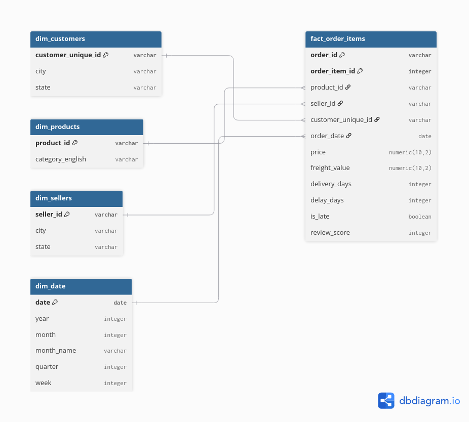
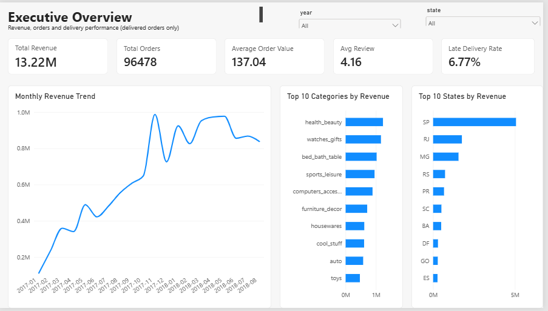
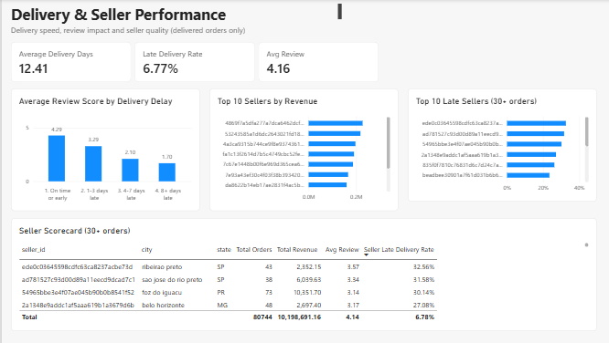
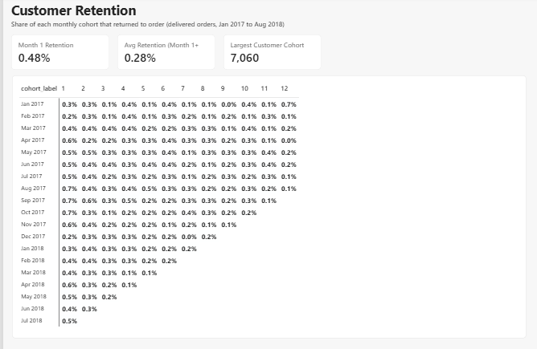
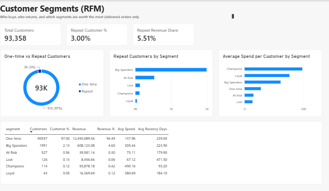
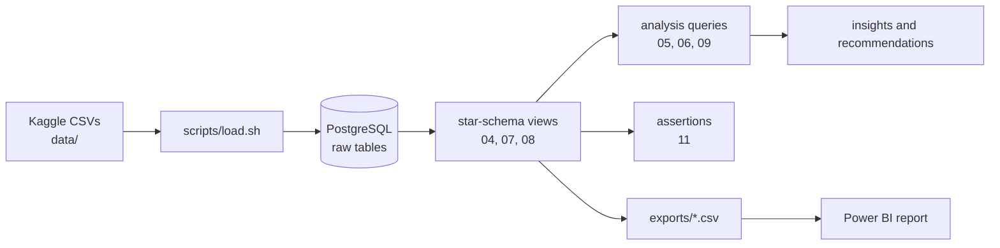

# Olist E-Commerce Analytics: Revenue, Delivery and Retention

End-to-end analytics on 99k real marketplace orders: PostgreSQL for cleaning, modelling and analysis, Power BI for a 4-page dashboard, and written business recommendations.

[](https://github.com/Ritik0835/olist-ecommerce-analytics/actions/workflows/tests.yml)
[](LICENSE)


**Headline findings:** late deliveries are associated with a drop in average review score from 4.29 to 2.27, and 97% of customers placed only one order in the observed window.

## Business Problem

Four questions drive the project:

1. Where does revenue come from (category, state, seller) and how is it growing?
2. How much do delivery delays hurt review scores?
3. How well are customers retained, and which customers are the most valuable?
4. Which sellers and categories need fixing, and which should be scaled?

## Dataset

[Brazilian E-Commerce Public Dataset by Olist](https://www.kaggle.com/datasets/olistbr/brazilian-ecommerce) (Kaggle): about 99,441 orders placed between Sep 2016 and Oct 2018 across 9 tables (customers, orders, order_items, order_payments, order_reviews, products, sellers, geolocation, category translation).

## Tools

- PostgreSQL: schema design, data quality checks, views, CTEs, window functions (`LAG`, `SUM OVER`, `NTILE`, `ROW_NUMBER`, `DISTINCT ON`)
- Power BI Desktop: star-schema model, DAX measures, 4 report pages
- Git and GitHub

## Data Model

A star schema built as views in `sql/04_star_schema_views.sql`. One row in the fact table is one order item.



## Key Assumptions

Full detail and the check behind each one is in `sql/03_cleaning_checks.sql`.

- **Revenue** = sum of item `price` for **delivered orders only** (freight excluded). Total: R$13,221,498.11 across 96,478 orders.
- **Payments are not used for revenue.** 2,961 orders have more than one payment row, which would double count revenue if joined to items.
- **Customer identity:** `customer_id` changes with every order, so retention and RFM use `customer_unique_id`.
- **Late delivery** = delivered date (date part) later than the estimated date. Used the same way in SQL and Power BI.
- **Reviews:** `review_id` is not unique in the raw data (99,224 rows, 98,410 distinct ids), so the key is `(review_id, order_id)`. 547 orders have more than one review; the latest is used.
- **Date range:** 2016 and the last months of 2018 are sparse. Trend charts and cohorts use Jan 2017 to Aug 2018.
- 8 delivered orders have no delivery date; their delay fields are NULL and excluded from late-delivery rates.

## Analysis Approach

| Area | File | What it does |
|---|---|---|
| Revenue | `05_revenue_analysis.sql` | Monthly revenue and AOV, month-over-month growth with `LAG`, cumulative revenue, top categories and states |
| Delivery | `06_delivery_analysis.sql` | Late vs on-time orders, delivery days by state, delay buckets vs review score |
| Cohorts | `07_cohort_retention.sql` | First-order month cohorts and month 0 to 12 retention on `customer_unique_id` |
| RFM | `08_rfm_segmentation.sql` | Recency and Monetary with `NTILE(5)`, Frequency by rule (1, 2, 3+), six segments |
| Sellers and categories | `09_seller_category.sql` | Top sellers, seller late % and review score (30+ orders), category revenue vs review vs late % |
| Assertions | `11_assertions.sql` | Fails if headline counts, revenue, RFM totals or cohort rows drift |
| Exports | `scripts/export_powerbi.sh` | Rebuilds the views and rewrites the seven Power BI CSVs |

## Key Insights

Detailed evidence and recommendations are in [`docs/insights.md`](docs/insights.md).

1. **Late delivery lowers satisfaction.** Late orders (6.77%) average a 2.27 review versus 4.29 on time. The score falls from 3.29 (1-3 days late) to 2.10 (4-7) to 1.70 (8+).
2. **Retention is very low.** 97.00% of customers ordered once. Month-1 retention is 0.48%. Repeat customers bring 5.51% of revenue.
3. **Revenue is concentrated.** Three categories make up 25.89% of revenue, and Sao Paulo is about 38%.
4. **Delivery is slow outside the south-east.** 8.70 average days in Sao Paulo versus 29.34 in Roraima.
5. **A few sellers drive poor service.** Five sellers with 30+ orders are late more than 26% of the time (top: 32.56%) against 6.77% overall.

*These are associations in observational data, and seller rates rest on small order counts.*

## Dashboard

The full report is in [`powerbi/olist-ecommerce-analytics.pbix`](powerbi/olist-ecommerce-analytics.pbix), with a PDF export at [`powerbi/olist-dashboard.pdf`](powerbi/olist-dashboard.pdf).

**Executive Overview**



**Delivery and Seller Performance**



**Customer Retention**



**Customer Segments (RFM)**



### Page guide

| Page | Question it answers | Main visuals |
|---|---|---|
| Executive Overview | How is revenue moving and where is it concentrated? | Monthly revenue and AOV, cumulative revenue, top categories, top states |
| Delivery and Seller Performance | Where does service break down? | Late vs on-time review score, delivery days by state, seller late % |
| Customer Retention | Do customers come back? | Cohort sizes and month-1 to month-12 retention |
| Customer Segments (RFM) | Who are the valuable customers? | Segment counts, revenue share and average spend |

## Recommendations

- Escalate orders that are more than 3 days late (proactive message, quick refund or reship path) and review how estimated dates are set in slow regions.
- Build a post-purchase email or coupon flow for higher-value first-time buyers to lift repeat purchases.
- Test growth outside Sao Paulo and reduce dependence on a few categories.
- Add regional fulfilment or local sellers for the slowest northern states.
- Introduce a seller scorecard (late %, review score, orders) with a support-or-penalty process, and check quality in Bed Bath & Table and Office Furniture.

## Project Structure

```
olist-ecommerce-analytics/
  data/        raw Olist CSVs (download from Kaggle; gitignored)
  sql/         01_schema ... 11_assertions
  scripts/     load, analysis and Power BI export entry points
  exports/     CSVs loaded by Power BI (deterministic row order)
  powerbi/     .pbix report and PDF export
  docs/        insights, limitations, images and query outputs
  tests/       stdlib validation of the committed exports
  .github/     CI that runs the export tests
  README.md
```



## How to Run

1. Download the Olist dataset from Kaggle and place the 9 CSV files in `data/`.
2. Build the database with the loader. It creates the database if needed and
   refuses to overwrite a populated one:
   ```bash
   bash scripts/load.sh          # first run
   bash scripts/load.sh --reset  # rebuild from the raw CSVs
   ```
   Missing data files, SQL errors and empty databases fail with a clear
   message.
3. Re-run every analysis and the assertions:
   ```bash
   bash scripts/run_analysis.sh > analysis_output.txt
   ```
   The final `11_assertions.sql` block fails if orders, delivered orders, fact
   rows, revenue, RFM totals or cohort rows drift from the documented values.
4. Regenerate the Power BI exports:
   ```bash
   bash scripts/export_powerbi.sh
   ```
   The script rebuilds the cohort and RFM views, then rewrites all seven CSVs
   in `exports/`. Ordering is explicit, so a repeat run is byte-identical.
5. Open `powerbi/olist-ecommerce-analytics.pbix` in Power BI Desktop (Windows).
   The report reads the CSV files in `exports/`; if Power BI cannot find them,
   update the paths under **Transform data > Data source settings**.

### Tests and CI

```bash
python -m unittest discover -s tests -v
```

The 9 tests need no database. They check export row counts, primary keys,
revenue reconciliation, referential coverage, the eight missing delay
measures, cohort completeness and the RFM totals. GitHub Actions runs the same
suite on every push to `main`.

## Limitations

These are associations in observational data, not causal effects. Revenue is
product price for delivered orders only (freight and payments excluded), 97%
of customers ordered once, and the dashboard PDF is a snapshot because Power BI
cannot be rebuilt on Linux. The full list, including review and seller caveats,
is in [`docs/limitations.md`](docs/limitations.md).

## Author

Ritik | [GitHub](https://github.com/Ritik0835) | [LinkedIn](https://www.linkedin.com/in/ritik-sharma-zzz0835)
