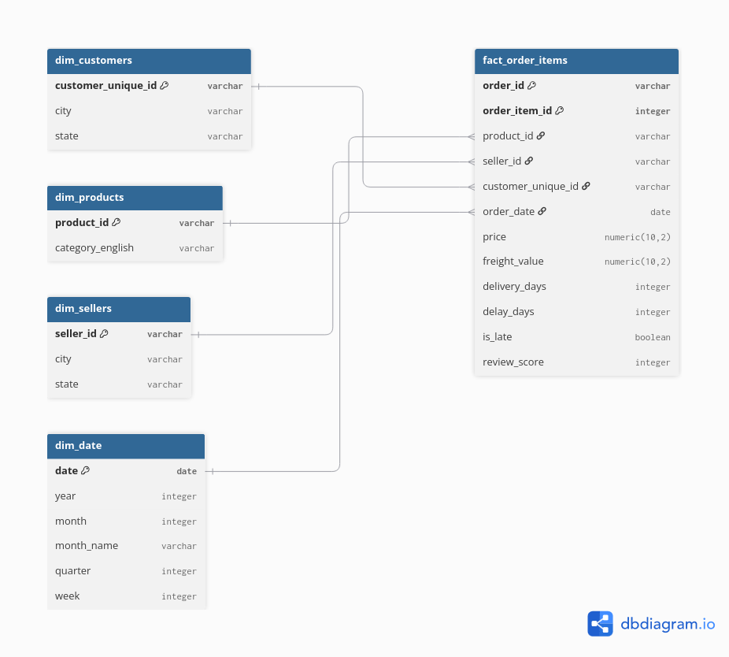
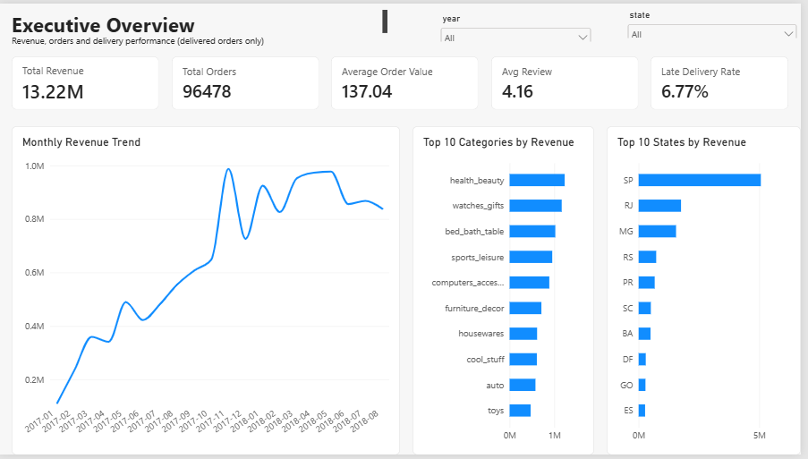
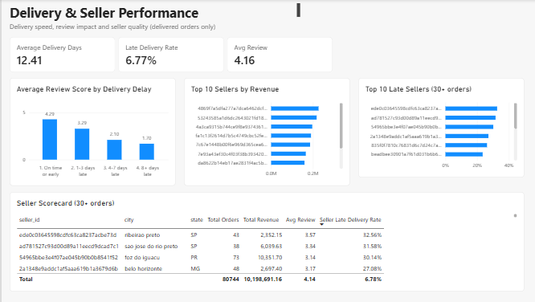
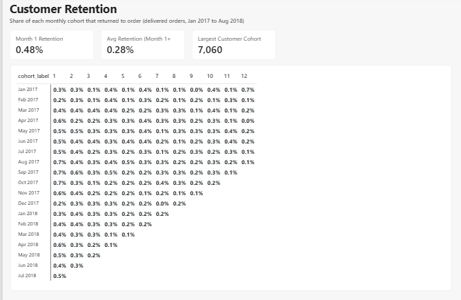
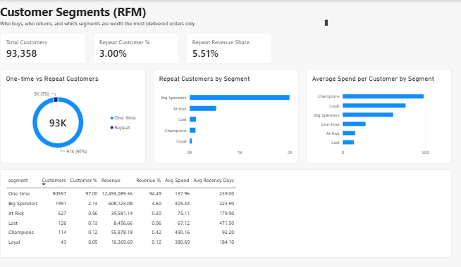

# Olist E-Commerce Analytics: Revenue, Delivery and Retention

End-to-end analytics on 99k real marketplace orders: PostgreSQL for cleaning, modelling and analysis, Power BI for a 4-page dashboard, and written business recommendations.

**Headline findings:** late deliveries are associated with a drop in average review score from 4.29 to 2.27, and 97% of customers placed only one order in the observed window.

## Business Problem

Four questions drive the project:

1. Where does revenue come from (category, state, seller) and how is it growing?
2. How much do delivery delays hurt review scores?
3. How well are customers retained, and which customers are the most valuable?
4. Which sellers and categories need fixing, and which should be scaled?

## Dataset

[Brazilian E-Commerce Public Dataset by Olist](https://www.kaggle.com/datasets/olistbr/brazilian-ecommerce) (Kaggle): about 99,441 orders placed between Sep 2016 and Oct 2018 across 9 tables (customers, orders, order_items, order_payments, order_reviews, products, sellers, geolocation, category translation).

## Tools

- PostgreSQL: schema design, data quality checks, views, CTEs, window functions (`LAG`, `SUM OVER`, `NTILE`, `ROW_NUMBER`, `DISTINCT ON`)
- Power BI Desktop: star-schema model, DAX measures, 4 report pages
- Git and GitHub

## Data Model

A star schema built as views in `sql/04_star_schema_views.sql`. One row in the fact table is one order item.



## Key Assumptions

Full detail and the check behind each one is in `sql/03_cleaning_checks.sql`.

- **Revenue** = sum of item `price` for **delivered orders only** (freight excluded). Total: R$13,221,498.11 across 96,478 orders.
- **Payments are not used for revenue.** 2,961 orders have more than one payment row, which would double count revenue if joined to items.
- **Customer identity:** `customer_id` changes with every order, so retention and RFM use `customer_unique_id`.
- **Late delivery** = delivered date (date part) later than the estimated date. Used the same way in SQL and Power BI.
- **Reviews:** `review_id` is not unique in the raw data (99,224 rows, 98,410 distinct ids), so the key is `(review_id, order_id)`. 547 orders have more than one review; the latest is used.
- **Date range:** 2016 and the last months of 2018 are sparse. Trend charts and cohorts use Jan 2017 to Aug 2018.
- 8 delivered orders have no delivery date; their delay fields are NULL and excluded from late-delivery rates.

## Analysis Approach

| Area | File | What it does |
|---|---|---|
| Revenue | `05_revenue_analysis.sql` | Monthly revenue and AOV, month-over-month growth with `LAG`, cumulative revenue, top categories and states |
| Delivery | `06_delivery_analysis.sql` | Late vs on-time orders, delivery days by state, delay buckets vs review score |
| Cohorts | `07_cohort_retention.sql` | First-order month cohorts and month 0 to 12 retention on `customer_unique_id` |
| RFM | `08_rfm_segmentation.sql` | Recency and Monetary with `NTILE(5)`, Frequency by rule (1, 2, 3+), six segments |
| Sellers and categories | `09_seller_category.sql` | Top sellers, seller late % and review score (30+ orders), category revenue vs review vs late % |

## Key Insights

Detailed evidence and recommendations are in [`docs/insights.md`](docs/insights.md).

1. **Late delivery lowers satisfaction.** Late orders (6.77%) average a 2.27 review versus 4.29 on time. The score falls from 3.29 (1-3 days late) to 2.10 (4-7) to 1.70 (8+).
2. **Retention is very low.** 97.00% of customers ordered once. Month-1 retention is 0.48%. Repeat customers bring 5.51% of revenue.
3. **Revenue is concentrated.** Three categories make up 25.89% of revenue, and Sao Paulo is about 38%.
4. **Delivery is slow outside the south-east.** 8.70 average days in Sao Paulo versus 29.34 in Roraima.
5. **A few sellers drive poor service.** Five sellers with 30+ orders are late more than 26% of the time (top: 32.56%) against 6.77% overall.

*These are associations in observational data, and seller rates rest on small order counts.*

## Dashboard

The full report is in [`powerbi/olist-ecommerce-analytics.pbix`](powerbi/olist-ecommerce-analytics.pbix), with a PDF export at [`powerbi/olist-dashboard.pdf`](powerbi/olist-dashboard.pdf).

**Executive Overview**



**Delivery and Seller Performance**



**Customer Retention**



**Customer Segments (RFM)**



## Recommendations

- Escalate orders that are more than 3 days late (proactive message, quick refund or reship path) and review how estimated dates are set in slow regions.
- Build a post-purchase email or coupon flow for higher-value first-time buyers to lift repeat purchases.
- Test growth outside Sao Paulo and reduce dependence on a few categories.
- Add regional fulfilment or local sellers for the slowest northern states.
- Introduce a seller scorecard (late %, review score, orders) with a support-or-penalty process, and check quality in Bed Bath & Table and Office Furniture.

## Project Structure

```
olist-ecommerce-analytics/
  data/        raw Olist CSVs (download from Kaggle)
  sql/         01_schema ... 09_seller_category
  exports/     CSVs loaded by Power BI (fact, dimensions, cohort, RFM summary)
  powerbi/     .pbix report and PDF export
  docs/        insights.md and images
  README.md
```

## How to Run

1. Download the Olist dataset from Kaggle and place the 9 CSV files in `data/`.
2. Create the database and load the data, from the repository root:
   ```bash
   createdb olist
   psql -d olist -f sql/01_schema.sql
   psql -d olist -f sql/02_load.sql
   ```
3. Run the checks and build the star schema:
   ```bash
   psql -d olist -f sql/03_cleaning_checks.sql
   psql -d olist -f sql/04_star_schema_views.sql
   ```
4. Run the analysis scripts `05` to `09` in order (`08` also creates the RFM views).
5. Open `powerbi/olist-ecommerce-analytics.pbix` in Power BI Desktop (Windows). The report reads the CSV files in `exports/`; if Power BI cannot find them, update the paths under **Transform data > Data source settings**.

## Author

 [GitHub](https://github.com/Ritik0835) | [LinkedIn](https://www.linkedin.com/in/ritik-sharma-zzz0835)
